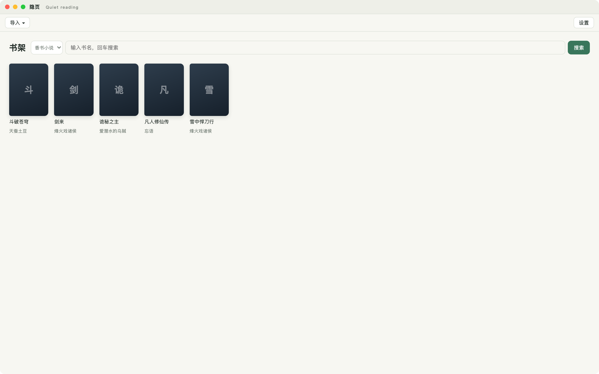
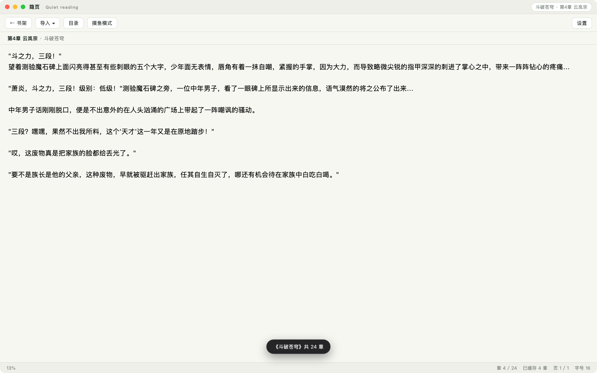
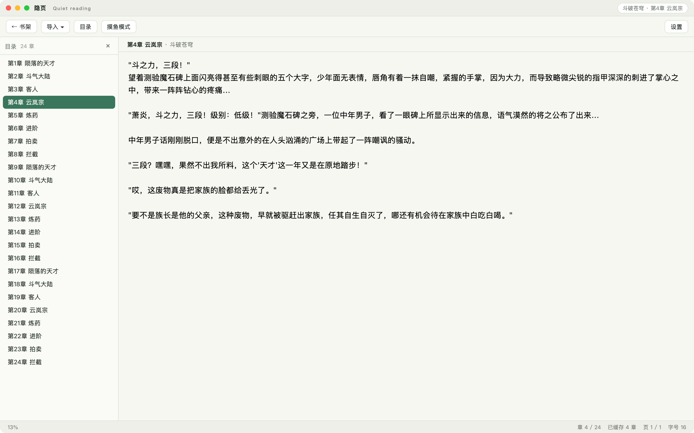
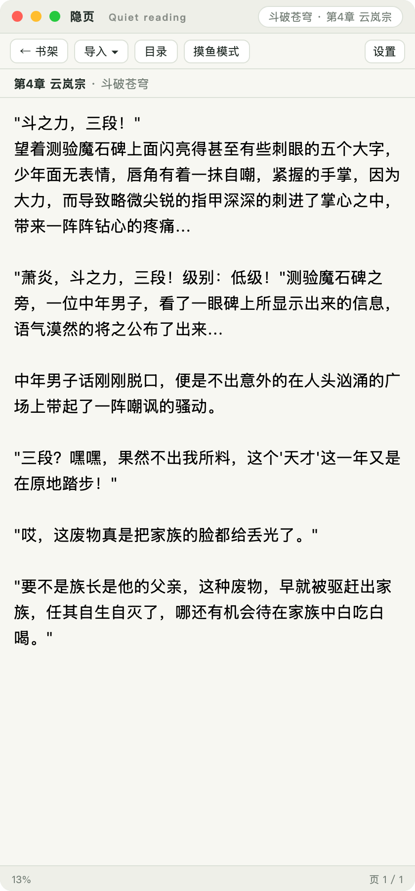
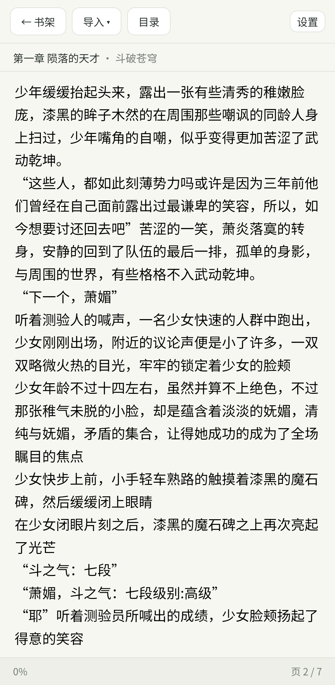
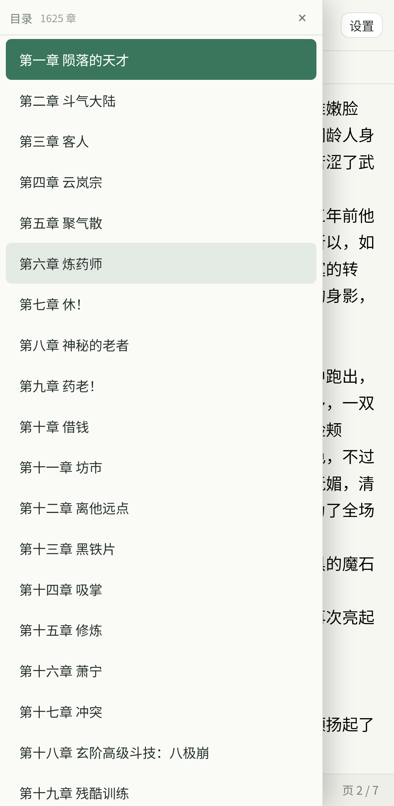
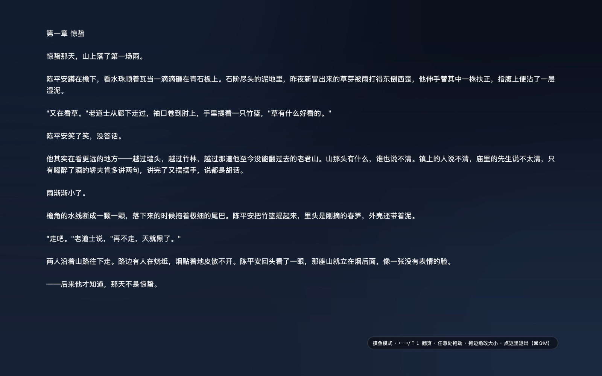

<div align="center">

# 隐页 · YinYe

**一个可以光明正大摸鱼的小说阅读器**
桌面一个小窗口，手机一个 App，同一套代码。

`Tauri 2` · `Rust` · `原生 HTML/CSS/JS` · macOS + 安卓

</div>

---

## 这是什么

隐页（名字取「看不见的那一页」）是个小说阅读器：

- **桌面端**是一个无边框、透明背景的小窗口，可以缩成一条、可以一键藏起来，看起来就像某个内部工具的一角；
- **手机端**是一个普通安卓 App，上下滑或点屏幕两边翻页，通勤路上补两章。

两端共用同一份前端和同一份 Rust 抓书、解析、缓存逻辑，桌面与安卓的区别只在「外壳」和少量交互（老板键、拖窗只桌面有；触摸翻页、返回键只手机有）。

## 截图

| 桌面 · 书架 | 桌面 · 阅读 |
| --- | --- |
|  |  |

| 桌面 · 目录（推开式左侧栏） | 窄到 420px 也能读 |
| --- | --- |
|  |  |

| 安卓 · 阅读 | 安卓 · 搜索 | 安卓 · 目录 |
| --- | --- | --- |
|  |  |  |

**摸鱼模式**：标题栏、工具栏、状态栏全部消失，窗口变纯透明，只剩正文浮在桌面上。鼠标悬停会浮出退出提示，`⌘⇧M` 也能进出。



> 上图背景是示意壁纸，实际就是你桌面上的东西透过来。

## 功能

**桌面**

- 无边框透明小窗，可任意拉伸（最小 160×90），窗口位置和大小会记住
- 老板键 `⌘ \`` / `Alt \`` 全局隐藏与唤出；「摸鱼模式」窗口变纯透明，只剩文字浮在桌面上
- 书源搜索 → 加入书架 → 在线阅读；边看边缓存，自动预读后 3 章
- 目录走「推开式」左侧栏（246px），窄窗口自动退回浮层
- 字号调整、字色调整（只作用于正文，不动界面）、上下 / 左右两种翻页
- 进度按「第几章 + 第几行」保存：改窗口大小、切字号后仍回到同一行，不漏字也不跳页
- 导入本地 `txt` / `md`；粘贴文章，或丢一个链接自动抓正文
- 整本下载到 `~/Downloads/摸鱼小说/书名.txt`

**安卓**

- 上下滑动、或点屏幕左 / 右三分之一翻页，点中间收起工具栏
- 返回键先回书架，再退出；适配状态栏和手势条的安全区
- 书架、搜索、目录、按章缓存、字号字色都在，默认字号 17（手机上比桌面大一档）
- 不做「整本下载」：手机要的是随手看两页，不是攒文件

## 下载

打好的包都在 [Releases](https://github.com/mengchangan-ai/moyu-yinye-reader/releases)：

| 平台 | 文件 | 说明 |
| --- | --- | --- |
| macOS（Apple Silicon） | `yinye-0.3.0-aarch64.dmg` | 拖进「应用程序」就能装。没签名也没公证，第一次打开要**右键 → 打开**（或在「隐私与安全性」里点「仍要打开」） |
| 安卓 | `yinye-android-0.3.0.apk` | universal，32/64 位都在里面，约 30MB。debug keystore 自签名，装的时候要允许「未知来源」；换手机重装若提示签名冲突，先卸载旧的 |

仓库里的 `dist/` 也留了一份 APK，方便直接下。桌面包当前只出了 **macOS arm64** 一个，Intel Mac / Windows / Linux 没有打包（见「已知边界」）。

## 自己构建

前置：Node.js 18+、Rust stable、以及 Tauri 的平台依赖（macOS 需要 Xcode Command Line Tools）。

```bash
npm install
npm run tauri dev      # 开发：起本地静态服务 + Tauri 窗口
npm run tauri build    # 出安装包（macOS 产物在 src-tauri/target/release/bundle/）
```

安卓（额外需要 JDK 17、Android SDK + NDK）：

```bash
rustup target add aarch64-linux-android armv7-linux-androideabi
npm install
npm run tauri android init          # 仓库已带 gen/android，可以跳过
npm run tauri android build --apk   # 只要 APK；不加 --apk 默认出 .aab
```

产物：`src-tauri/gen/android/app/build/outputs/apk/universal/release/app-universal-release.apk`

`gen/android/app/build.gradle.kts` 相对官方模板改了两处，别照抄生成模板覆盖掉：

1. release 也用 debug keystore 签名（自己装手机不会被系统拒）；
2. release 放开明文 HTTP —— 书源里有 `http://` 站点，Android 9+ 默认禁明文，不放开就是搜索、翻章全部「请求失败」。

## 书源

两个 HTML 规则书源，放在 `src-tauri/src/rules/`：

| id | 名称 | 站点 |
| --- | --- | --- |
| 1 | 香书小说 | <http://www.ibiqugu.net/> |
| 9 | 笔趣阁22 | <https://www.22biqu.com/> |

规则就是一个 JSON：`search` / `toc` / `chapter` 三段 CSS 选择器，加正文过滤正则（广告行、站点水印）。照着现有格式新加一个 `*.json` 就能加书源，`src-tauri/src/downloader/` 是吃这套规则的引擎（搜索、目录翻页、正文清洗、多线程整本下载）。

> 第三方站点随时会改版或挂掉，规则失效时得自己改选择器。仓库里只有规则和代码，不存小说内容。

## 项目结构

```
server.mjs                    开发用静态服务器（只服务 src/，端口 5173）
src/                          前端（无框架，纯 HTML/CSS/JS）
  index.html
  app.js                      书架 / 阅读 / 目录 / 设置 / 导入 全部交互
  style.css                   三套主题变量（玻璃 / 亮 / 暗）+ 排版
src-tauri/
  src/lib.rs                  Tauri 命令：搜索、书架、章节、封面、窗口、老板键
  src/downloader/             书源规则引擎（搜索、目录、正文、整本下载）
  src/rules/*.json            书源规则
  src/store.rs                书架与阅读进度的本地存储
  src/downloads.rs            整本下载任务（4 个 worker 抢同一队列，可暂停）
  tauri.conf.json             窗口、标识、版本（当前 0.3.0）
  gen/android/                安卓工程（Tauri 生成，已按上面说明改过）
  icons/                      应用图标
docs/screens/                 截图
scripts/check-layout.mjs      开发期排版自检脚本（无头 Chrome 量各尺寸有没有溢出）
```

阅读进度的存储思路值得一提：**不存页码，存「第几章 + 第几行」**。窗口一变尺寸，页码立刻失效，只有行号还能定位，重排后往前倒着切页、往后正着切，那一行正好落在页首，前后翻页仍然接得上。

## 已知边界

- 书源是第三方站点，随时可能失效；规则坏了要自己改
- 安卓包用 debug 签名，自装没问题，上架应用商店得换正式签名
- **只出了 macOS（arm64）和安卓两个包**：只在这两个平台上跑过；Windows / Linux 没打包、没验证，Intel Mac 也没单独出包（代码里 `bundle.targets` 只有 `app` / `dmg`）
- 「整本下载」只在桌面端有，手机端只有按章缓存
- 不内置任何小说正文，书架为空是正常的，先搜一本

## 免责声明

本项目只做阅读器外壳与解析规则：所有内容都来自第三方网站，仓库不包含任何小说正文。请支持正版阅读，使用本项目产生的一切后果由使用者自行承担。

## License

[MIT](LICENSE) © 2026 西瓜

截图里的书名与正文片段属于原作者与出版方，仅用于演示界面。
